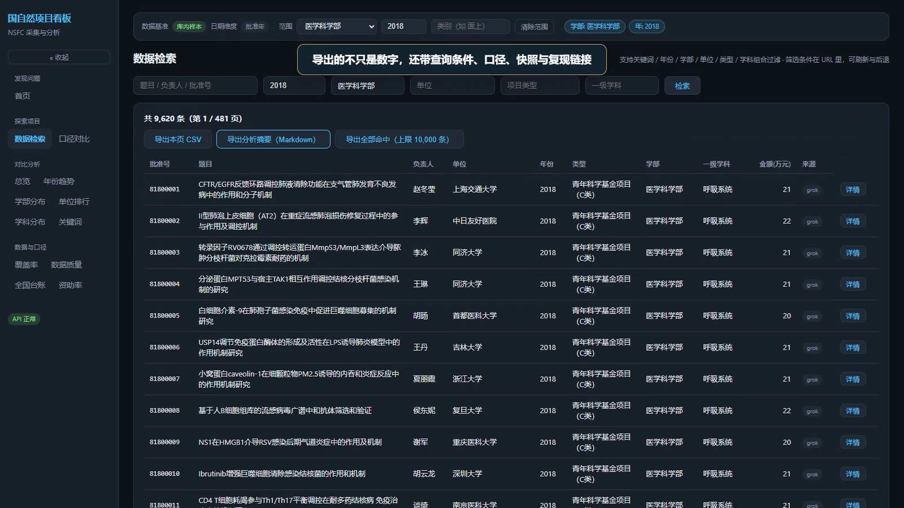

# 科研资助探索台

从一个问题出发，让每个数字都有来路。

Atria Demo 共建作品 · 作者 **xyc**。主体开发 Qoder/Atria；Codex 独立评审、最终修复与提交整理。



## 直接体验

下载或克隆本仓库，进入根目录：

```text
python start-demo.py
```

打开 http://127.0.0.1:8000/ 。仅监听本机；不需要 API Key。需要 Python 3.14（实际测试版本）。首次启动还原 data/unified.db.gz 并校验 SHA-256，不覆盖已有不同版本数据库。

## 从源码开发

```text
cd web
npm ci
npm run build
cd ..
python start-demo.py
```

后端测试：`python -B -m unittest discover -s tests -t .`；前端测试：进入 `web` 后运行 `npm test`。数据采集与完整重建需要额外来源资产，日常运行使用仓库冻结快照，不需要启动采集。

## 功能与使用说明

见 [Demo说明.md](Demo说明.md)。后端 66 项、前端 68 项自动测试通过；前端生产构建通过。

不是全国全量数据，也不是 AI 自动给出因果结论的工具。金额推断、同名人员和缺测范围均需按界面提示解读。冻结数据在用户确认可公开后随仓库提供；不启动新采集。

公开的是本次提交快照，不包含私人开发仓库历史、凭据、node_modules 或无关项目。第三方库及数据遵循各自声明；本仓库公开不代表作者有权替第三方重新授权。

